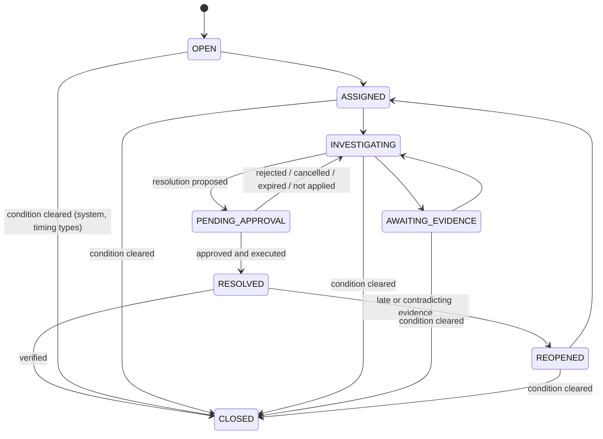

# Stage 17 — Reconciliation exceptions

## 1. Types (ADR-049 §5; mapping from ADR-030 §4)

| Type | ADR-030 name | Default severity | Closes by itself |
|---|---|---|---|
| MISSING_PAYMENT | MISSING_IN_FUNDZIM (incoming) | HIGH | no |
| MISSING_PAYOUT | MISSING_IN_FUNDZIM (outgoing) | CRITICAL | no |
| MISSING_SETTLEMENT | MISSING_IN_PROVIDER | HIGH (payment) / CRITICAL (payout) | yes |
| MISSING_LEDGER_ENTRY | STATUS_MISMATCH (record without journal) | HIGH | yes |
| MISSING_BANK_CREDIT | — (new) | MEDIUM | yes |
| AMOUNT_MISMATCH | AMOUNT_MISMATCH | HIGH (CRITICAL for refunds above the payment) | no |
| CURRENCY_MISMATCH | CURRENCY_MISMATCH | CRITICAL | no |
| FEE_MISMATCH | FEE_MISMATCH | MEDIUM | no |
| PAYOUT_MISMATCH | PAYOUT_MISMATCH | CRITICAL | no |
| STATUS_MISMATCH | STATUS_MISMATCH | LOW (timing) to CRITICAL (money moved against FundZim's record) | yes |
| DUPLICATE_TRANSACTION | DUPLICATE | HIGH | no |
| AMBIGUOUS_MATCH | — (new) | MEDIUM / HIGH | no |
| UNKNOWN_PAYMENT_OUTCOME / UNKNOWN_PAYOUT_OUTCOME | — (new) | HIGH / CRITICAL | yes (when the record becomes final by another path) |
| UNMATCHED_BANK_ENTRY | — (new) | HIGH (credit) / CRITICAL (debit) | no |
| POSSIBLE_DONOR_FUNDS_IN_OPERATING_ACCOUNT | — (new, Model A) | CRITICAL | no |
| SETTLEMENT_SHORT / SETTLEMENT_OVER | same | HIGH | no |
| CONFLICTING_EVIDENCE | — (new) | HIGH | no |
| PROVIDER_ADJUSTMENT | — (new) | LOW (fee) / MEDIUM | no |
| STALE_RECONCILIATION | — (new) | MEDIUM | yes |

Severities are engineering defaults (what is likely to mean money in the wrong place), not regulatory classifications;
no reporting duty is attached to any of them (LR-008, LR-051 stay open).

## 2. Lifecycle

Guarded by `app.guard_transition('recon_exception')` (Go edge list `ExceptionEdges` checked against the migration by a
unit test) and `recon.exceptions_close_guard`: an unresolved case closes only with reason CONDITION_CLEARED and only for
the timing types above, never while an approval is pending; a resolved case closes as RESOLVED. History is append-only
(`recon.exception_events`: OPENED, SEEN_AGAIN, ASSIGNED, STATUS_CHANGED, COMMENT, EVIDENCE_ADDED, DUE_DATE_SET,
ESCALATED, RESOLUTION_*, CLOSED, REOPENED). Actions carry the expected `version` (STALE_VERSION on conflict).

## 3. Deduplication and recurrence

One live case per dedupe key (`<type>:item:<line>` for line problems, `<type>:source:<source>:<subject>` for record
problems, `<type>:batch:<batch>`, `STALE_RECONCILIATION:source:<source>:<currency>`). A later run that sees the problem
again bumps `occurrences`, `last_seen_at` and raises the severity if a higher one applies. A problem that returns after
its case was CLOSED opens a new generation.

## 4. Assignment

`assign` (OPEN/REOPENED → ASSIGNED, or reassign) requires an assignee who holds `reconciliation.investigate`
(`auth.StaffWithPermission`); a due date is optional and set by the assigner — **no SLA is configured or invented**
(as ADR-046). The assignee alone may start the investigation. Escalation by age happens only when the active rule set
sets `escalate_after_hours` (ESCALATED event, audit).

## 5. Operations portal

The reconciliation snapshot contributes open exceptions (CRITICAL→SEV1, HIGH→SEV2, MEDIUM→SEV3, LOW→SEV4) to the Stage 14
exception centre; triage there never resolves them (resolution stays in reconciliation).
