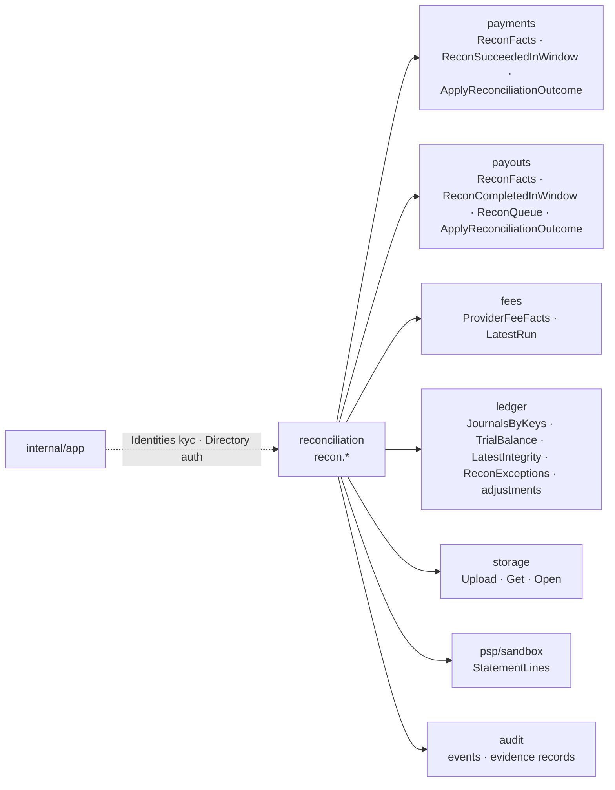
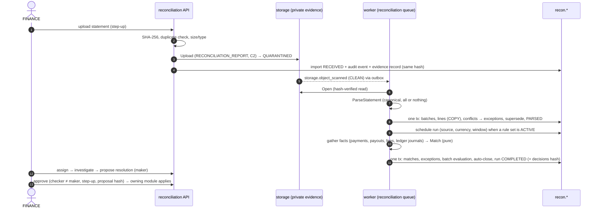

# Stage 17 — Reconciliation architecture

Decision record: [ADR-049](../adr/ADR-049-reconciliation-and-settlement-operations.md) (implements ADR-030). Code:
`internal/reconciliation`, wiring `internal/app/reconciliation.go`, migrations `20261022090000_reconciliation` and
`20261022090100_payout_rate_limited_retry`.

## 1. Place in the module graph

`reconciliation` owns every table of the `recon` schema and nothing else (archtest). It never writes another module's
table: payments and payouts change only through their own `ApplyReconciliationOutcome` (their state machines, source
`RECON`), the ledger only through `ledger.Service` (adjustments). No module imports `reconciliation`. It uses the app
pool (`fundzim_app`); `fundzim_app` has no ledger privilege, so a ledger write and a recon write never share a
transaction (ADR-049 §8).

## 2. Data model (`recon`)

| Table | Purpose | Mutability |
|---|---|---|
| `sources` | configured statement streams (TEST only by CHECK): kind, provider, authority rank, format | immutable; seeded |
| `matching_rule_sets` | maker-checker parameters of the matcher; one ACTIVE, one PENDING at a time | status columns only; terminal states frozen |
| `imports` | one row per statement file: SHA-256 (unique), stored object, evidence record, statement metadata, counts, validation report | metadata written once while PARSING; RECEIVED → PARSING → PARSED/FAILED; PARSED → SUPERSEDED |
| `settlement_batches` | settlement report headers; credits − debits − fees = net (CHECK) | status and expectation only; MATCHED only when lines add up and are settled (trigger) |
| `items` | normalised statement lines, identity (source, external line id, revision) | `match_status` only; never deleted |
| `runs` | one matching pass for (source, currency, window); one active per scope (unique index) | counters while RUNNING; terminal frozen |
| `matches` | line ↔ subject ↔ journal with confidence, rule set version, matcher version, explanation | ACTIVE → REVOKED only; one active per line |
| `exceptions` | differences; dedupe key; lifecycle; one live case per key | lifecycle columns only; CLOSED frozen |
| `exception_events` | append-only history | insert only |
| `resolutions` | maker-checker resolutions; proposal hash; execution result | decision/execution columns only; terminal frozen |
| `worker_heartbeats` | per-job health | upsert |

Every status column is guarded by `app.guard_transition` with the edges in `app.status_transitions` (`recon_import`,
`recon_settlement_batch`, `recon_run`, `recon_match`, `recon_exception`, `recon_resolution`, `recon_rule_set`); the Go
edge list for exceptions is checked against the migration by a unit test. No row is ever deleted (`app.forbid_mutation`).

## 3. Flow

## 4. Workers

| Job | Schedule | Does |
|---|---|---|
| consumer `reconciliation.imports` (on `storage.object_scanned`) | event | parses the statement once its scan is CLEAN (REJECTED → import FAILED `SCAN_REJECTED`) |
| `reconciliation.parse` | 1 min | sweeper: RECEIVED imports whose event was missed; PARSING imports older than 5 min (crash) |
| `reconciliation.match` | 1 min | reaps runs whose heartbeat stopped (10 min → FAILED `WORKER_LOST`); schedules a run per (source, currency) with open lines or new statements; executes queued runs (SKIP LOCKED claim) |
| `reconciliation.ageing` | 10 min | expires undecided proposals (24 h), retries approved executions, opens/closes STALE_RECONCILIATION, escalates by the rule set's optional age |

All on the dedicated River queue `reconciliation` (never delays payments, payouts or notifications). Every job writes a
heartbeat (`recon.worker_heartbeats`); a job that never succeeded is UNKNOWN on the dashboard, never HEALTHY.

## 5. Idempotency and concurrency

- Same file twice: refused by `uq_recon_imports_content_sha256` (409 `DUPLICATE_IMPORT`), races included.
- Same statement reference twice: `uq_recon_imports_statement` (import FAILED `DUPLICATE_STATEMENT`) unless the new
  import supersedes the old one explicitly (once: `uq_recon_imports_superseded_once`).
- Same line in an overlapping statement: recorded once (any earlier revision with the same hash → duplicate).
- Parsing: the PARSING claim is a guarded transition; recording is one transaction that re-checks the claim.
- Runs: one active per (source, currency) (unique index); claim QUEUED → RUNNING under a row lock; a reaped run's
  late commit is refused (`RUN_NOT_RUNNING`).
- Matches: one ACTIVE per line (unique index, `ON CONFLICT DO NOTHING`).
- Exceptions: one live case per dedupe key (unique index); a recurrence bumps `occurrences`.
- Resolutions: one live per exception (unique index); approval binds the proposal hash; execution is keyed in the owning
  module (payment/payout evidence key `recon:item:<line>`, ledger adjustment id) so a retry never applies twice.

## 6. What it never does

Post a settlement journal; change a payment, payout, reservation or journal directly; resubmit a payout; release funds;
combine or convert currencies; match by amount alone; treat a provider acknowledgement as settlement; accept a
production statement.
