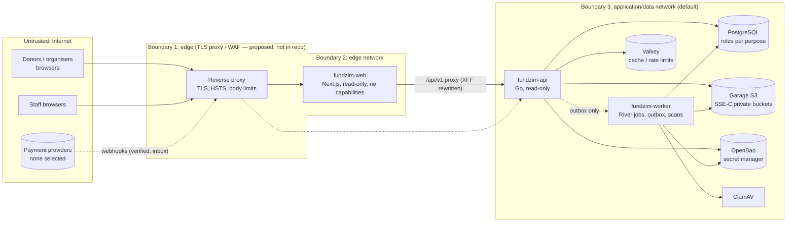
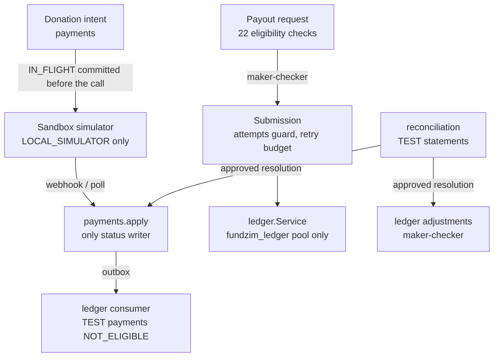

# Stage 18 — Security architecture

Consolidates the security design of Stages 1–18 as it is **implemented** (development topology, `compose.yaml`) and as
it is **proposed** for production (deployment-security.md). Older detail stays in `docs/SECURITY.md` and the stage
documents; this page is the map. Nothing here is a production claim.

## 1. Components and trust boundaries

| Boundary | What crosses it | Controls (implemented) |
|---|---|---|
| Internet → edge | HTTPS requests, webhooks | proposed proxy terminates TLS (production config refuses http URLs, `sslmode` other than `verify-full`, `redis://`, http S3, http OpenBao outside development) |
| Edge → web | browser requests | per-request nonce CSP, security headers, no secrets in the bundle, `method="post"` credential forms |
| Web → API | same-origin `/api/v1` proxy, server renders | X-Forwarded-For replaced by exactly one observed address; the API trusts it only from the web container (`TRUSTED_PROXY_CIDRS` = its fixed edge address); body caps |
| API → data services | SQL, S3, KV v2 | one role per purpose (app, worker, kyc, compliance, ledger, migrator, backup), grants from the catalogue, RLS on compliance, SSE-C per object, secrets by reference only |
| Worker → data services | jobs, scans, verification | worker role; outbox is the only API → worker channel; financial jobs on PostgreSQL (River) |
| Provider → API | webhooks | signature + timestamp window + replay dedupe (inbox), CURRENT/PREVIOUS secrets; no real provider adapter exists (ADR-040) |
| Staff → admin | admin routes | MFA at sign-in (staff), step-up for sensitive permissions (TOTP only for staff), maker-checker in Go and the database, 404 for non-staff |

Network segmentation (Stage 18): the web container is only on `edge`; it cannot resolve or reach PostgreSQL, Valkey,
Garage, OpenBao or ClamAV (verified: DNS `EAI_AGAIN`, direct IP timeout).

## 2. Financial transaction boundaries

Every arrow into money state passes a Go constant that is `false` in production and a database CHECK that refuses
PRODUCTION rows (security-control-register.md C-FIN-*); Stage 18 adds regression tests that fail when either changes.

## 3. Data access paths

| Data | Store | Who reads / writes | Notes |
|---|---|---|---|
| Accounts, sessions, MFA (TOTP secrets AES-GCM) | `app` schema | `fundzim_app` (API) | tokens stored as SHA-256; recovery codes HMAC |
| KYC (C3) | `kyc` schema, private-kyc bucket | `fundzim_kyc` pool only | audited access, download tickets |
| Compliance | `compliance` schema (RLS) | `fundzim_compliance` | restrictions projection |
| Ledger | `ledger` schema | `fundzim_ledger` only | append-only, TEST designation |
| Audit | `audit` schema | insert-only for runtime roles; verification worker-only | two hash chains, checkpoints, retention registry |
| Reconciliation | `recon` schema | `fundzim_app`/`worker` (no DELETE) | immutable lines |
| Backups | encrypted files outside the stack | `fundzim_backup` (read-only, BYPASSRLS) | key file outside the backup directory |

## 4. Secrets infrastructure

Provider credentials (Stage 9) and, with `FIELD_ENCRYPTION_PROVIDER=secretstore`, every application key (Stage 18)
are `secretref://fundzim/<environment>/…` references resolved from OpenBao KV v2 (AppRole required in production; static
tokens and plain HTTP refused). Locally OpenBao runs in dev mode (in memory). Details: secrets-management.md.

## 5. Monitoring, logging and alerting

Structured JSON logs with key redaction and free-text scrubbing; Prometheus metrics on internal listeners; module
`OpsSnapshot`s; the worker's security scan raises persisted alerts (security-monitoring.md). No log or alert leaves the
platform (no external channel is configured).

## 6. Backup and recovery infrastructure

`scripts/backup/` (encrypted backup, MAC manifest, restore drill, failure drills) and `scripts/dr/exercise.sh`;
evidence in `app.ops_backup_runs` (backup-recovery.md, disaster-recovery.md).

## 7. CI/CD

GitHub Actions with `contents: read`, SHA-pinned actions, no repository secrets, no deployment; jobs: Go (vet, race,
govulncheck, gosec), web (lint, types, tests, build, audit), mock E2E, real-stack E2E, integration (incl. destructive
migration round trip), container images (SBOM, Trivy, checksums, provenance), contracts, secret scanning.
`internal/deploytest` enforces the workflow policy (supply-chain-security.md).

## 8. Administrative interfaces

Staff portal under `/admin` (permission-aware navigation is presentation only; every route enforces its policy), staff
CLI `fundzimctl` (config check, migrations — down only in development/test, bootstrap ceremony, verify, backup record).
There is no superuser role, no override permission and no shared administrator account.
